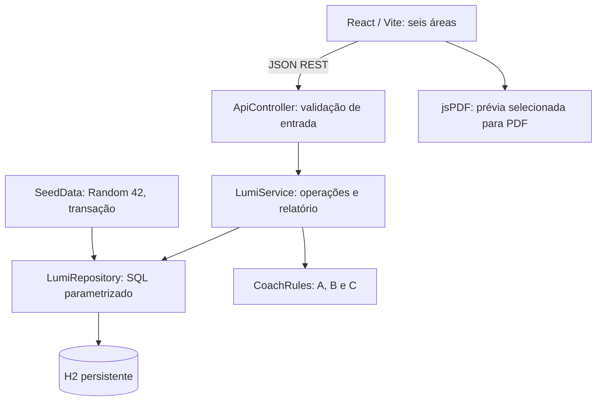

# Arquitetura

`Models` contém registros imutáveis para Usuaria, Sinal, Menstruacao, Sintoma, Compromisso e Insight. Não há ORM: o repository usa Spring JDBC com SQL parametrizado. Usuaria 1:N SinalDiario/Menstruacao/Sintoma/Compromisso. Insight é calculado e não persistido. Banco e seed são locais. `ApiErrors` converte falhas de validação/duplicidade para JSON; `ApiConfig` controla CORS.

A aplicação possui uma persona fixa. `LumiService.check` rejeita outros IDs. A data de referência vem de propriedade injetada. As regras são funções determinísticas sobre listas e data, testáveis sem servidor ou banco.

## Regras implementadas

A: noites D-2 até D versus D-32 até D-3, sem sobreposição. Exige 3 medidas recentes e pelo menos 21 das 30 de referência; retorna médias/diferença em minutos. Com poucos dados, apresenta insuficiência.

B: últimos 7 dias, FADIGA >=6/10, com contagem de datas distintas. >=3 dias ativa “recorrente”. Compara descritivamente médias de passos nos dias com fadiga e nos demais dias disponíveis. Ausência de sintomas não é interpretada como ausência de fadiga. Duplicar sintoma no mesmo dia não aumenta recorrência.

C: agendamentos nos próximos 30 dias (incluindo hoje e limite final); passados ainda AGENDADO recebem aviso para conferir realização. Nenhum exame ou periodicidade é sugerido.

Não implementamos as antigas propostas R2/R3 sobre FC/temperatura/fase lútea: exigiriam inferências que não fazem parte do escopo seguro solicitado. A proposta anterior de seis regras foi substituída pelas três A/B/C expressamente pedidas.

## Relatório e privacidade

POST /relatorio recebe lista fechada de categorias e retorna somente elas. Se insights estiver selecionado, suas fontes também entram (aviso explícito na interface). A prévia e o PDF usam `reportLines` sobre o mesmo JSON. Nenhuma chamada a clínica ou serviço de IA ocorre. Todos os registros, inclusive inserções durante o ensaio, são tratados como fictícios.

## Edital

O documento anexado confirma pitch em 28/10/2026, 19h–22h, e maior peso para código funcional. Melhor aderência: eixo I (acompanhamento e lembretes) e IV (informação educativa). Não reivindicar o eixo II apenas por funcionar sem relógio: ele descreve análise/visualização de dados públicos e lacunas de cobertura, ausentes neste MVP. O critério 5 menciona “efeitos climáticos”, aparentemente um resquício editorial; confirmar com a organização, sem assumir alteração do tema de saúde feminina.
